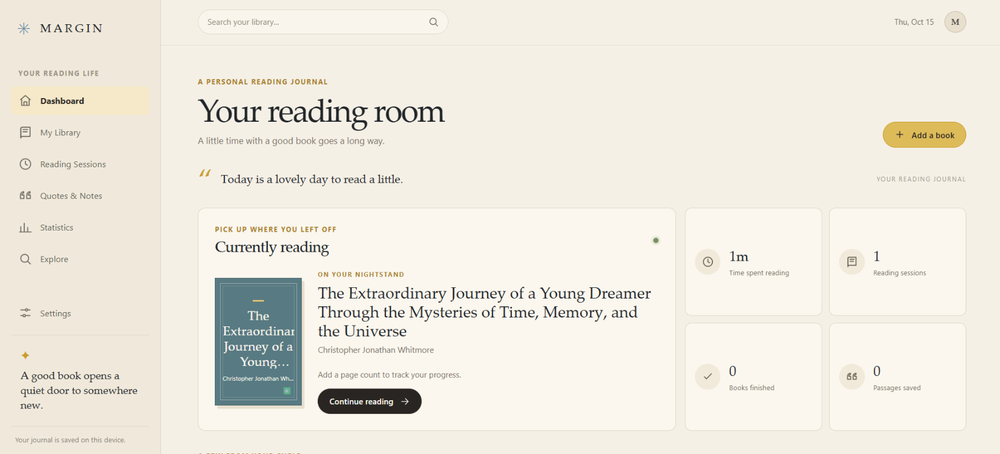
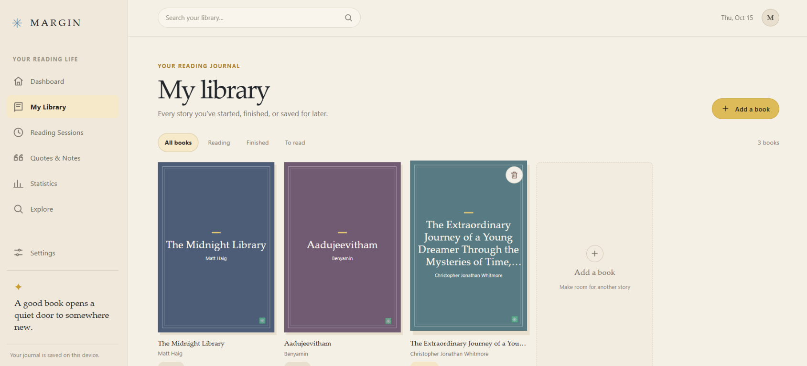

# MARGIN A personal reading journal

[](https://aromalsp123.github.io/Book-tracker/)

MARGIN is a calm, personal reading journal built for readers who want to track
what they read, how long they spend reading, and what passages matter enough to
keep. It is designed to feel like a quiet reading ritual rather than another
productivity dashboard: warm paper tones, bookish visuals, and lightweight,
low-friction interactions sit at the center of the experience.

This project is more than a list of books. It is a private reading life: your
library, your progress, your notes, your reading sessions, and the small moments
that make a book memorable.

## Why MARGIN exists

Many reading trackers focus on quantity: pages, streaks, and completion bars. MARGIN
starts from a different idea.

- a book is a personal experience, not just a task
- reading time should be easy to record without friction
- quotes and notes should live next to the book they came from
- a library should help you remember where you are, not just add titles
- personal data should remain private and under your control


That philosophy is reflected in the app's flow: build a collection, update page
progress, log sessions, capture passages, and look back at patterns over time.

## At a glance

- Local-first reading journal for personal tracking
- Book library with read/current/to-read states
- Page-progress updates and reading-session logging
- Time tracking support for external services such as Toggl and Threeggle
- Favorite passages and notes attached to books
- Reading summaries, stats, and dashboard views
- Optional signed-in account flows with shared catalog metadata and richer browsing
- Browser-stored personal data with a public catalog model for shared book metadata

## Highlights

### Personal library management

MARGIN keeps a personal library that can grow naturally over time. You can track
which books are planned, currently being read, or already finished. Each record can
carry its own status, progress, and context, making the library useful both for an
active reading life and for looking back over years of books.

### Reading progress and sessions

The journal is not only about a to-read pile. It supports real reading progress:

- page counts and current-page tracking
- reading session logs
- active reading timers
- elapsed time summaries
- progress estimates and reading pace views

This makes it useful for readers who want both a sense of momentum and a record of
what they actually read.

### Quotes, notes, and memory anchors

A good book often leaves a sentence, paragraph, or idea worth keeping. MARGIN lets
readers save those memorable passages alongside the book they came from, turning a
reading log into a continuing journal of reflection.

### Dashboard and statistics

The app is designed to surface patterns quickly. A reader can look at the current
book, recent sessions, elapsed time, and high-level summaries without needing to dig
through the whole library. This is especially helpful when a book spans weeks or a
reading season includes many titles.

### Shared metadata without exposing private reading history

The project includes a carefully structured shared catalog layer for authors,
works, and editions. Personal books remain connected to the owner, while shared
bibliographic metadata is separated from private reading data. This makes it a strong
example of a product that balances personal records with reusable, public catalog
information.

## Website screenshots

### Home page


### Reading dashboard



### Personal library



## How the app works

MARGIN is built as a modern frontend application with a lightweight backend and
supporting services.

### Frontend

- React + TypeScript for the UI and app logic
- Vite as the application build and dev server
- CSS styling with a warm, editorial, paper-inspired look
- browser-side state for local journal data

### Backend and data model

The project includes Firebase-backed infrastructure for richer experiences:

- Firestore for user-owned records and shared catalog information
- Authentication for signed-in flows
- Cloud Functions for backend logic and integrations
- shared catalog records for authors, works, and editions
- operational tooling and data migrations for schema evolution

This means the app is not just a static local-only notebook: it can support richer
book metadata, cross-user catalog linking, and server-side operations while keeping
reader-owned records separate from shared bibliographic data.

### Privacy model

The core journaling experience is intentionally private. The personal reading
journal remains a personal record, and the app's design emphasizes local use and
owner-controlled data. Shared catalog metadata is deliberately separated from the
private library so that readers keep ownership of their reading life while the app
still benefits from common bibliographic information.

> Your data is device-local unless you are using the account-backed features of the
> app. Clearing browser site data or switching devices will not transfer the local
> journal automatically. Back up or export important data before clearing storage.

## Open the website

Visit **[MARGIN](https://aromalsp123.github.io/Book-tracker/)** to open the live website
published site.

## Local development

Requirements: Node.js 22.18 or newer and npm.

```bash
git clone https://github.com/Aromalsp123/Book-tracker.git
cd Book-tracker
npm ci
npm run dev
```

Then open the URL printed by Vite, usually `http://localhost:5173`.

### Production build

```bash
npm run build
npm run preview
```

This produces a build that can be previewed locally. The project also includes
release and deployment scripts for GitHub Pages and Firebase-backed services.

## Testing and validation

The repository includes a substantial test suite for the frontend, Firebase rules,
backend behavior, and catalog/data validation.

Useful commands:

```bash
npm run check
npm run test:unit
npm run test:rules
npm run test:pwa
npm run test:functions
npm run build
```

The project also has a larger validation entry point:

```bash
npm run validate
```

This is useful before release or when making changes to the app's data model,
server rules, integrations, or metadata flows.

## Project structure

A quick overview of the repository layout:

```text
book-tracker/
├── src/                     # frontend app and shared logic
├── functions/               # backend functions and server-side logic
├── tests/                  # automated tests
├── docs/                   # architecture, release notes, and technical docs
├── public/                 # static assets and generated site output
├── cloudflare/             # deployment assembly utilities
├── MIGRATIONS.md           # migration history and data evolution notes
├── package.json            # app scripts and dependencies
├── vite.config.ts          # Vite setup
├── README.md              # project overview and contributor guide
└── ...
```

## Architecture notes

The project includes technical documentation in the `docs/` directory that explains
how responsibilities are split across the browser, server, and shared catalog. This
is especially valuable when working with routing, access boundaries, integrations,
and release workflows.

Key references:

- [`docs/architecture/README.md`](docs/architecture/README.md)
- [`docs/catalog.md`](docs/catalog.md)
- [`docs/time-tracking-release.md`](docs/time-tracking-release.md)
- [`MIGRATIONS.md`](MIGRATIONS.md)

## Deployment and release

The app includes deployment scripts for static publishing and backend deployment:

```bash
npm run pages:assemble
npm run pages:deploy
npm run deploy:backend
npm run release
```

The production site is assembled into `public/`, and GitHub Pages deployment is
used for the published app. At the same time, Firebase services are used for the
app's backend and data layer.

## Contributing

Contributions are welcome if they improve the reading experience, strengthen the
project architecture, or make the app more reliable and useful for readers.

A few good starting points:

- improve reading summaries and dashboard views
- refine the library and progress workflows
- extend time-tracking and session recording reliability
- improve metadata, validation, or book-linking flows
- improve accessibility and reading comfort in the interface

Before submitting substantial changes, review the docs in `docs/` and the project
scripts in `package.json` so that the work matches the repo's testing and release
patterns.

## License

No license has been specified for this project. Contact the repository owner before
reusing or redistributing the source, artwork, or published content.
